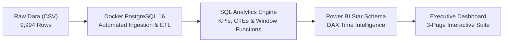
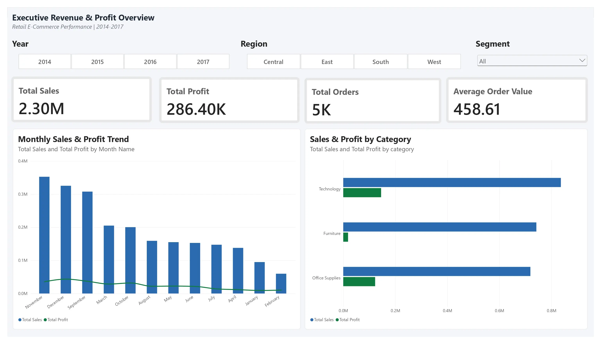
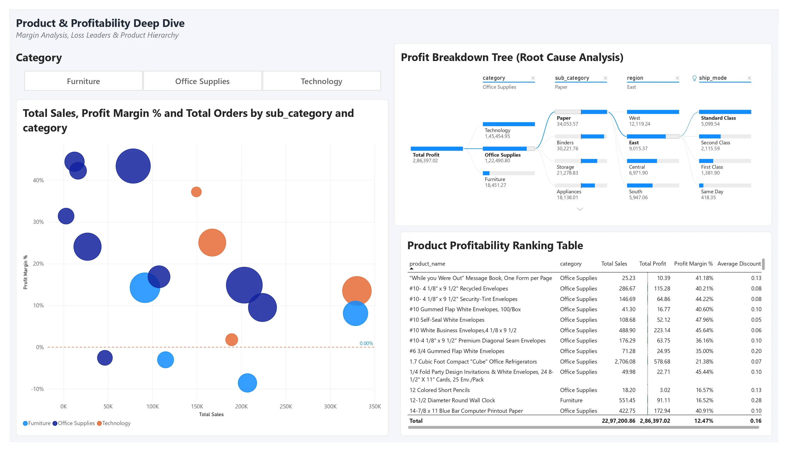
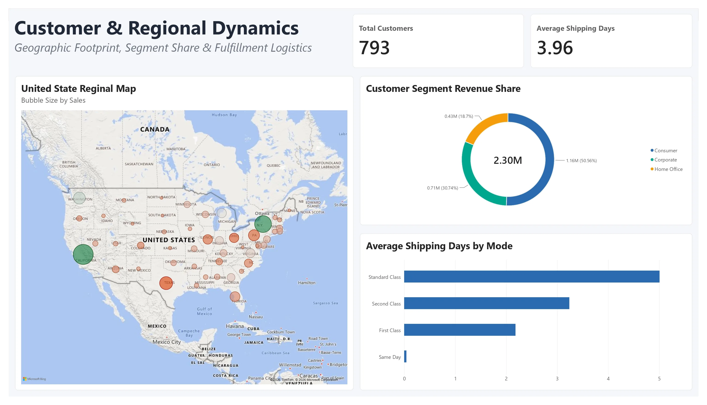
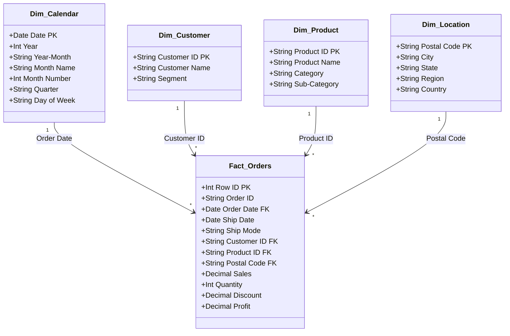

# Retail Sales Intelligence Dashboard

[](https://powerbi.microsoft.com/)
[](https://learn.microsoft.com/en-us/dax/)
[](https://www.postgresql.org/)
[](https://www.pgadmin.org/)
[](https://www.docker.com/)
[](https://opensource.org/licenses/MIT)

An enterprise-grade, end-to-end retail business intelligence platform and executive analytics dashboard built on a containerized PostgreSQL 16 database and Microsoft Power BI. Featuring automated schema ingestion, a Star Schema data model, 10+ time-intelligence DAX measures, and an interactive 3-page executive reporting suite that uncovers **$2.30M in revenue trends**, regional shipping dynamics, and critical margin drain across product sub-categories.

## Links

- **Portfolio Website**: [swagat-portfolio.onrender.com](https://swagat-portfolio.onrender.com)
- **Power BI Report File**: [`power_bi/Retail Sales Intelligence Dashboard.pbix`](./power_bi/Retail%20Sales%20Intelligence%20Dashboard.pbix)
- **SQL Analytics Script**: [`sql/analysis_queries.sql`](./sql/analysis_queries.sql)
- **Raw Transaction Dataset**: [`data/superstore_sales.csv`](./data/superstore_sales.csv)

---

## 1. Project Overview & Business Problem

**Retail Sales Intelligence Dashboard** delivers an end-to-end analytics workflow engineered to eliminate blind spots in commercial revenue reporting, unmonitored discount leakage, and regional logistics bottlenecks. It bridges raw transactional records with persistent relational storage and an executive-ready Power BI reporting suite.



### Problem Solved

Traditional retail reporting often relies on static spreadsheets and superficial revenue figures that mask critical profitability leaks:
- **The "High Revenue, Low Margin" Mirage**: Sub-categories with massive sales volumes can silently drain company profitability when excessive discounts (>20%) are offered without margin safeguards.
- **Regional Logistics Friction**: Divergent delivery turnaround times and shipping surcharges erode margins in geographically challenging states.
- **Unstructured Analytical Data**: Flat, denormalized transactional tables cause severe query degradation and report maintenance overhead in enterprise BI tools.

### Target Users & Stakeholders

- **Chief Commercial Officer (CCO) & Executive Leadership**: To evaluate company-wide revenue targets, profit margins, and Year-over-Year (YoY) trajectories.
- **Category & Merchandising Managers**: To identify "Loss Leaders", optimize product mix, and calibrate discount thresholds.
- **Supply Chain & Logistics Directors**: To track shipping mode performance, state-by-state fulfillment turnarounds, and shipping latency.
- **Data Analytics & BI Hiring Teams**: To examine production-grade Star Schema modeling, advanced DAX time intelligence, containerized database engineering, and end-to-end data governance.

---

## 2. Core Business Insights & Executive Summary

Across the 4-year retail dataset (~9,994 transactions), the platform processed and validated the following business KPIs:

| Metric | Value | Business Impact / Benchmark |
| :--- | :--- | :--- |
| **Total Net Revenue** | **$2,297,200.86** (~$2.30M) | Stable multi-year upward trajectory with recurring Q4 seasonal peaks |
| **Total Net Profit** | **$286,397.02** (~$286.4K) | Healthy overall baseline profit driven by Technology and Office Supplies |
| **Overall Profit Margin** | **12.47%** | Strong margin benchmark; heavily dragged down by unmonitored sub-categories |
| **Total Orders Fulfilled** | **5,009 Orders** (~5K) | High order throughput spanning 4 US geographical regions |
| **Unique Active Customers** | **793 Accounts** | High repeat order density across Consumer and Corporate segments |
| **Average Order Value (AOV)** | **$458.61** | Stable commercial cart size across B2B and B2C segments |
| **Average Delivery Turnaround** | **3.96 Days** (~4.0 Days) | Within standard shipping SLAs; First Class averages 2.2 days |

### Key Analytical Findings

1. **The "Discount Trap" & Loss Leaders**:
   - The **`Tables`** sub-category generated **$206.9K** in revenue but incurred a net loss of **-$17,725.48** (-8.6% margin) due to an average discount rate of **26.1%**.
   - **`Bookcases`** and **`Supplies`** also generated negative cumulative returns under aggressive promotional discounting.
2. **High-Margin "Cash Cows"**:
   - **`Technology`** generated the highest net profit (**$145,454.95**), led by **`Phones`** ($44.5K profit) and **`Copiers`** ($55.6K profit with an exceptional **>32%** profit margin).
   - In **`Office Supplies`**, **`Paper`** produced **$34,053.57** in net profit at an outstanding **43.4%** margin with minimal promotional dependency.
3. **Q4 Seasonality & Surge Volume**:
   - Peak commercial activity occurs consistently in **November and December**, where combined revenue exceeds **$300,000+ per month**, driving ~30% of annual retail revenue.
4. **Geographic Divergence**:
   - **California** (+$76.4K profit) and **New York** (+$74.0K profit) are the primary profit engines.
   - Conversely, **Texas** (-$25.7K) and **Ohio** (-$17.0K) generated severe net losses caused by aggressive regional markdown rates and freight overhead.
5. **Customer Segment Contribution**:
   - **`Consumer`**: Represents **50.56%** of total revenue ($1.16M).
   - **`Corporate`**: Represents **30.74%** of total revenue ($0.71M) with the highest AOV.
   - **`Home Office`**: Represents **18.70%** of total revenue ($0.43M).

---

## 3. Interactive Power BI Dashboard Showcase

The complete interactive reporting suite consists of three specialized executive views designed for multi-tier stakeholder analysis:

---

### Page 1: Executive Revenue & Profit Overview

<p align="center">
  <a href="./power_bi/page1_executive_overview.webp">
    
  </a>
  <br>
  <em><b>Figure 1: Executive Revenue & Profit Overview</b> — Company-wide KPI ribbon ($2.30M Sales, $286.4K Profit), 4-year seasonality trend line, and category profit comparison. (Click image to inspect in full resolution)</em>
</p>

**Core Purpose**: High-level commercial health monitor providing leadership with real-time revenue targets, net margin trajectories, monthly holiday surge patterns, and multi-category profit contributions.

- **Header Slicer Bar**: Interactive slicers for `Year` (2014–2017), `Region` (Central, East, South, West), and `Segment` (Consumer, Corporate, Home Office).
- **Executive KPI Ribbon**: Real-time summary cards displaying **$2.30M Total Sales**, **$286.40K Total Profit**, **5K Total Orders**, and **$458.61 Average Order Value (AOV)**.
- **Monthly Sales & Profit Trend**: Clustered column and line visualization mapping revenue seasonality, highlighting dramatic November/December holiday volume surges (> $300K/month).
- **Sales & Profit by Category**: Comparative bar chart evaluating revenue volume against bottom-line profit yields across Technology, Furniture, and Office Supplies.

> 💡 **Executive Takeaway**: While `Furniture` generates over **$742K** in gross sales, it yields only **$18.5K** in net profit (~2.5% margin), exposing heavy promotional compression compared to `Technology` (**$145.5K** profit at 17.4% margin).

---

### Page 2: Product & Profitability Deep Dive

<p align="center">
  <a href="./power_bi/page2_product_profitability.webp">
    
  </a>
  <br>
  <em><b>Figure 2: Product & Profitability Deep Dive</b> — Margin analysis scatter plot with 0% break-even line, AI root-cause decomposition tree, and ranked product margin table. (Click image to inspect in full resolution)</em>
</p>

**Core Purpose**: Granular diagnostic tool engineered to identify "Loss Leaders", monitor discount elasticity across 17 sub-categories, and trace profit erosion from high-level categories down to shipping modes.

- **Quadrant Scatter Plot Matrix**: Plots all sub-categories across **Total Sales** (X-axis), **Profit Margin %** (Y-axis), and **Order Count** (Bubble Size), complete with a dynamic **0.00% Break-Even Reference Line**.
- **Profit Breakdown Tree (Root Cause Analysis)**: AI-powered decomposition tree interactively branching Total Net Profit (`$286,397.02`) through `Category > Sub-Category > Region > Ship Mode`.
- **Product Profitability Ranking Table**: Granular product-level performance matrix with in-cell conditional formatting (green positive bars, red loss indicators) and average discount percentages.

> 💡 **Executive Takeaway**: The **0.00% Break-Even Line** immediately isolates `Tables` (-$17.7K net loss) and `Bookcases` (-$3.5K net loss) as active margin drains caused by unmonitored discount rates exceeding 26%.

---

### Page 3: Customer & Regional Dynamics

<p align="center">
  <a href="./power_bi/page3_customer_regional.webp">
    
  </a>
  <br>
  <em><b>Figure 3: Customer & Regional Dynamics</b> — US geographic bubble map, customer segment revenue distribution (Consumer 50.56%), and carrier SLA delivery turnaround analysis. (Click image to inspect in full resolution)</em>
</p>

**Core Purpose**: Geographic footprint and supply chain dashboard assessing state-by-state net profitability, customer segment acquisition volume, and fulfillment carrier turnaround SLAs.

- **Logistics & Account KPIs**: High-level counters tracking **793 Total Customers** and **3.96 Average Shipping Days**.
- **United States Regional Map**: Bubble visual scaling circle diameter by Sales volume and color-coding profit margins across states (highlighting California/New York vs. Texas/Ohio).
- **Customer Segment Revenue Share**: Donut chart detailing revenue distribution across Consumer (50.56% / $1.16M), Corporate (30.74% / $0.71M), and Home Office (18.70% / $0.43M).
- **Fulfillment Logistics Turnaround**: Horizontal bar chart comparing average shipping days across `Standard Class` (5.0 days), `Second Class` (3.2 days), `First Class` (2.2 days), and `Same Day` (<0.1 days).

> 💡 **Executive Takeaway**: `California` (+$76.4K) and `New York` (+$74.0K) generate over **52%** of total net profits, whereas `Texas` (-$25.7K) and `Ohio` (-$17.0K) experience heavy losses caused by aggressive regional discounting and long-haul shipping overhead.

---

## 4. Architecture & Data Modeling

### Star Schema Architecture

Rather than analyzing a flat transactional table, the model is architected into an industry-standard **Star Schema** with one-to-many (`1:*`) relationships:



### Dynamic Calendar Table (DAX)

```dax
Dim_Calendar = 
ADDCOLUMNS (
    CALENDAR(DATE(2014, 1, 1), DATE(2017, 12, 31)),
    "Year", YEAR([Date]),
    "Year-Month", FORMAT([Date], "YYYY-MM"),
    "Month Name", FORMAT([Date], "MMMM"),
    "Month Number", MONTH([Date]),
    "Quarter", "Q" & FORMAT([Date], "Q"),
    "Day of Week", FORMAT([Date], "dddd")
)
```

---

## 5. Tech Stack & Engineering Highlights

- **Business Intelligence**: Microsoft Power BI Desktop
- **Calculation Engine**: DAX (Time Intelligence & Custom Measures)
- **Database**: PostgreSQL 16 (Alpine)
- **Database GUI**: pgAdmin 4
- **Containerization**: Docker & Docker Compose
- **Analytics**: Advanced SQL (CTEs, Window Functions, Audits)

---

## 6. Repository Structure

```text
retail-sales-intelligence-dashboard/
├── data/
│   └── superstore_sales.csv                    # Raw multi-year transactional dataset (~9,994 rows)
├── power_bi/
│   ├── Retail Sales Intelligence Dashboard.pbix # Primary executive Power BI dashboard
│   ├── page1_executive_overview.webp           # Page 1: Executive Revenue & Profit Overview
│   ├── page2_product_profitability.webp        # Page 2: Product & Profitability Deep Dive
│   └── page3_customer_regional.webp            # Page 3: Customer & Regional Dynamics
├── sql/
│   ├── init.sql                                # Automated schema creation & CSV COPY loader
│   └── analysis_queries.sql                    # Production business analytics & KPI queries
├── docker-compose.yml                          # Multi-container Postgres 16 & pgAdmin 4 orchestrator
├── .gitignore                                  # Git exclusions for OS caches, volumes & temporary files
└── README.md                                   # Comprehensive project documentation
```

---

## 7. Containerized Database & Local Setup

The repository includes a ready-to-use Docker Compose configuration running **PostgreSQL 16 Alpine** and **pgAdmin 4**:

```yaml
services:
  postgres:
    image: postgres:16-alpine
    container_name: superstore_postgres
    restart: always
    environment:
      POSTGRES_DB: superstore_db
      POSTGRES_USER: postgres
      POSTGRES_PASSWORD: postgrespassword
    ports:
      - "5432:5432"
    volumes:
      - ./data:/data:ro
      - ./sql/init.sql:/docker-entrypoint-initdb.d/init.sql:ro
      - ./sql/analysis_queries.sql:/analysis_queries.sql:ro
      - pgdata:/var/lib/postgresql/data

  pgadmin:
    image: dpage/pgadmin4:latest
    container_name: superstore_pgadmin
    restart: always
    environment:
      PGADMIN_DEFAULT_EMAIL: admin@superstore.com
      PGADMIN_DEFAULT_PASSWORD: admin
    ports:
      - "5050:80"
    depends_on:
      - postgres

volumes:
  pgdata:
```

### Automated Database Initialization

When the container launches for the first time, Docker automatically executes [`sql/init.sql`](./sql/init.sql) via `/docker-entrypoint-initdb.d/init.sql`:
1. Sets date style to ISO/MDY (`SET datestyle = 'ISO, MDY';`).
2. Creates the strongly-typed `retail_sales` table schema.
3. Loads all 9,994 transactional rows from `/data/superstore_sales.csv` via the native `COPY` command.

---

## 8. Advanced SQL Analytics Suite

The [`sql/analysis_queries.sql`](./sql/analysis_queries.sql) script provides enterprise-ready business intelligence queries. Below are key highlights:

### 1. Data Quality & Anomaly Detection

```sql
-- Check for anomalous transactions (negative sales, invalid discounts)
SELECT * 
FROM retail_sales 
WHERE sales < 0 OR discount < 0 OR discount > 1;

-- Check for order line duplicates
SELECT order_id, product_id, COUNT(*) AS duplicate_count
FROM retail_sales
GROUP BY order_id, product_id
HAVING COUNT(*) > 1;
```

### 2. Core Business KPIs

```sql
SELECT 
    ROUND(SUM(sales), 2) AS total_revenue,
    ROUND(SUM(profit), 2) AS total_profit,
    ROUND((SUM(profit) / SUM(sales)) * 100, 2) AS profit_margin_pct,
    COUNT(DISTINCT order_id) AS total_orders,
    COUNT(DISTINCT customer_id) AS unique_customers,
    ROUND(SUM(sales) / COUNT(DISTINCT order_id), 2) AS average_order_value
FROM retail_sales;
```

### 3. Loss-Leader Identification (The "Discount Trap")

```sql
-- Identify sub-categories generating net negative cumulative profits
SELECT 
    sub_category,
    ROUND(SUM(sales), 2) AS total_sales,
    ROUND(SUM(profit), 2) AS net_profit,
    ROUND((SUM(profit) / SUM(sales)) * 100, 2) AS profit_margin_pct,
    ROUND(AVG(discount) * 100, 2) AS avg_discount_pct
FROM retail_sales
GROUP BY sub_category
HAVING SUM(profit) < 0
ORDER BY net_profit ASC;
```

### 4. Month-over-Month (MoM) Growth Analysis via Window Functions

```sql
WITH monthly_summary AS (
    SELECT 
        DATE_TRUNC('month', order_date) AS sales_month,
        SUM(sales) AS revenue
    FROM retail_sales
    GROUP BY DATE_TRUNC('month', order_date)
)
SELECT 
    sales_month,
    ROUND(revenue, 2) AS current_month_revenue,
    ROUND(LAG(revenue, 1) OVER (ORDER BY sales_month), 2) AS previous_month_revenue,
    ROUND(
        ((revenue - LAG(revenue, 1) OVER (ORDER BY sales_month)) / 
         NULLIF(LAG(revenue, 1) OVER (ORDER BY sales_month), 0)) * 100, 
        2
    ) AS mom_growth_pct
FROM monthly_summary
ORDER BY sales_month;
```

### 5. High-Value Customer Analysis (Pareto 80/20 Rule)

```sql
SELECT 
    customer_name,
    segment,
    COUNT(DISTINCT order_id) AS total_orders_placed,
    ROUND(SUM(sales), 2) AS total_spend,
    ROUND(SUM(profit), 2) AS profit_contributed
FROM retail_sales
GROUP BY customer_name, segment
ORDER BY total_spend DESC
LIMIT 10;
```

---

## 9. DAX Measures Library

All analytical measures are centralized within a dedicated `_Measures` table:

### Core Base Measures

```dax
Total Sales = SUM(Fact_Orders[Sales])

Total Profit = SUM(Fact_Orders[Profit])

Total Orders = DISTINCTCOUNT(Fact_Orders[Order ID])

Total Quantity = SUM(Fact_Orders[Quantity])

Average Order Value (AOV) = DIVIDE([Total Sales], [Total Orders], 0)

Profit Margin % = DIVIDE([Total Profit], [Total Sales], 0)
```

### Time-Intelligence Measures

```dax
Sales LY = 
CALCULATE(
    [Total Sales],
    SAMEPERIODLASTYEAR(Dim_Calendar[Date])
)

YoY Sales Growth = [Total Sales] - [Sales LY]

YoY Sales Growth % = 
DIVIDE(
    [YoY Sales Growth],
    [Sales LY],
    0
)

Sales YTD = 
TOTALYTD(
    [Total Sales],
    Dim_Calendar[Date]
)
```

### Domain, Logistics & Dynamic UI Measures

```dax
Total Customers = DISTINCTCOUNT(retail_sales[customer_id])

Average Shipping Days = 
AVERAGEX(
    retail_sales,
    DATEDIFF(retail_sales[order_date], retail_sales[ship_date], DAY)
)

Profit Margin Status Color = 
IF(
    [Profit Margin %] >= 0.15, "#107C41",   -- Dark Green (Healthy Margin >= 15%)
    IF([Profit Margin %] >= 0.00, "#F7630C", -- Amber/Orange (Low Margin 0-14.9%)
    "#D83B01"                                -- Red (Unprofitable / Net Loss)
))
```

---

## 10. Data Governance & Quality Validation Pipeline

Before building reporting models in Power BI, raw transactional data is audited and validated via schema-level constraints and SQL quality routines:

1. **Relational Schema Constraints**: Data types explicitly cast (dates as `DATE`, monetary values as `NUMERIC(10,2)`, unit counts as `INT`) preventing parsing errors.
2. **Missing Value Auditing**: Verification queries ensure zero null values across primary foreign keys (`order_id`, `customer_id`, `product_id`).
3. **Primary & Compound Key Uniqueness**: Checks on `order_id` + `product_id` compound keys prevent duplicated transaction lines.
4. **Range & Logic Verification**: Validates that shipment dates do not precede order dates (`ship_date >= order_date`) and discount rates are bounded within `0.0` to `1.0`.
5. **Data Consistency**: Geographic naming and product sub-category taxonomies verified for consistent casing and categorization.

---

## 11. Quickstart & How to Run

### Prerequisites

- [Docker Desktop](https://www.docker.com/products/docker-desktop/)
- [Microsoft Power BI Desktop](https://powerbi.microsoft.com/)
- [Git](https://git-scm.com/)

### 1. Clone the Repository

```bash
git clone https://github.com/swagatgharat/retail-sales-intelligence-dashboard.git
cd retail-sales-intelligence-dashboard
```

### 2. Start PostgreSQL & pgAdmin Containers

```bash
docker compose up -d
```
- **PostgreSQL**: Accessible at `localhost:5432` (`superstore_db` / `postgres` / `postgrespassword`)
- **pgAdmin 4**: Accessible at `http://localhost:5050`
  - **Login Email**: `admin@superstore.com`
  - **Login Password**: `admin`

### 3. Open the Power BI Dashboard

1. Launch **Microsoft Power BI Desktop**.
2. Open [`power_bi/Retail Sales Intelligence Dashboard.pbix`](./power_bi/Retail%20Sales%20Intelligence%20Dashboard.pbix).
3. Interact with slicers across **Page 1**, **Page 2**, and **Page 3** to explore all insights.

---

## 12. Strategic Business Recommendations

Based on the quantitative findings of this analysis, the following executive interventions are recommended:

1. **Institute Strict Discount Thresholds on Furniture**:
   - Cap discounts on `Tables` and `Bookcases` at **10%** (currently averaging 26.1%). Transactions with >20% discount consistently lead to net negative margins.
2. **Double Down on High-Margin Tech & Office Supplies**:
   - Allocate higher marketing and inventory budgets to `Copiers` (>32% margin) and `Paper` (43.4% margin), which exhibit strong price inelasticity.
3. **Re-evaluate Shipping Partnerships in South & Central Regions**:
   - Address margin leakage in Texas and Ohio by transitioning bulky items from Standard Class freight to regionally negotiated regional carrier contracts.
4. **Corporate Loyalty Incentive Program**:
   - The `Corporate` segment delivers the highest Average Order Value ($458+). Introducing volume rebate tiers will secure annual contract renewals.

---

## 13. Author

**Swagat Gharat**
- **Website**: [swagat-portfolio.onrender.com](https://swagat-portfolio.onrender.com)
- **GitHub**: [@swagatgharat](https://github.com/swagatgharat)
- **LinkedIn**: [Swagat Gharat](https://linkedin.com/in/swagatgharat)

---

_Retail Sales Intelligence Dashboard © 2026. Built with Power BI, PostgreSQL, Docker & SQL._
